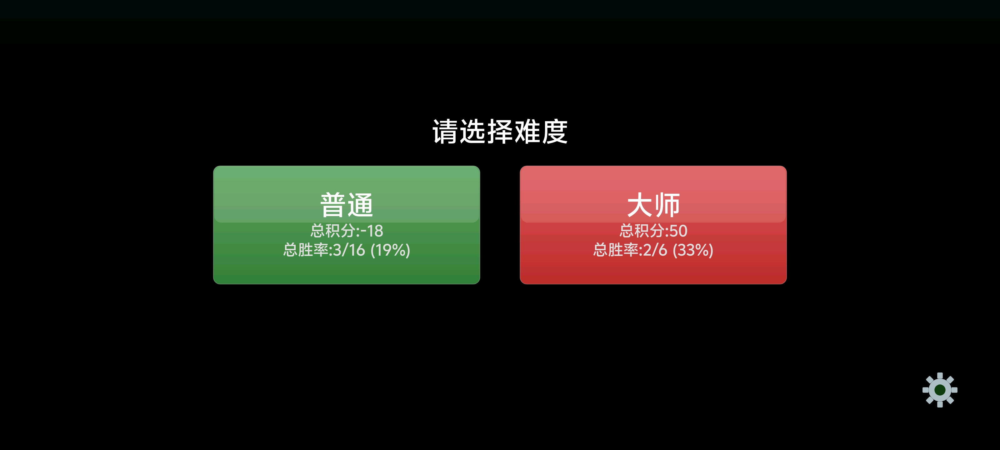
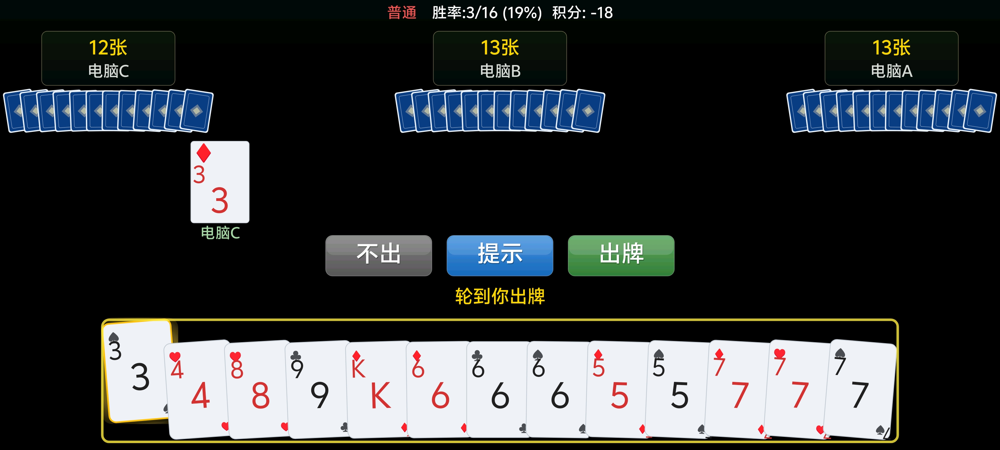
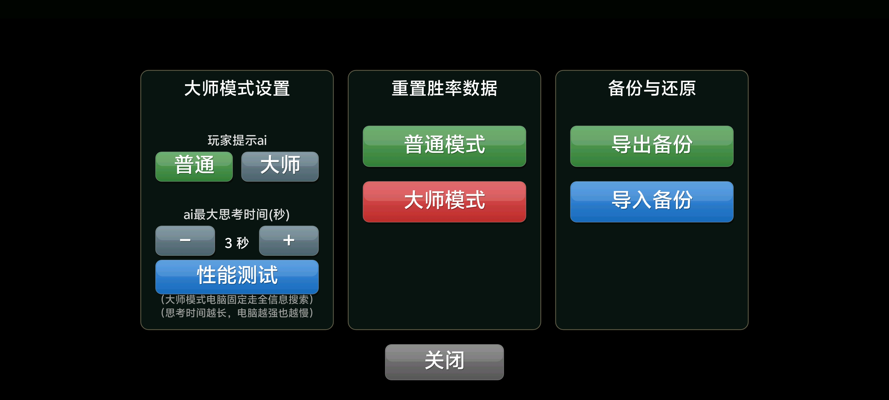

# 锄大D (Big Two / 大老二) 🃏

> 安卓锄大地单机小游戏：规则完整、AI 耐打、免权限、离线无广告，随时来一局。

## ✨ 特色功能 (Features)

- 🃏 **完整锄大地规则**：四人对局，你 vs 电脑 A / B / C；实现报单顶大、黑桃 2 翻倍、阶梯计分（剩牌越多扣分越多）等核心规则。
- 🤖 **两级 AI 陪练**：
  - **普通模式**：基于启发式规则的 AI 决策，出牌稳健、节奏快。
  - **大师模式**：完美信息搜索 AI，思考时间可调（2~60 秒，默认 5 秒），越想越狠。
- 🔇 **纯净无广**：纯单机离线，不索取非必要权限（仅振动反馈），不收集隐私。
- 🎨 **流畅体验**：低延迟音效引擎、手牌滑入 / 出牌动画、沉浸式全屏。
- 📊 **战绩统计**：按模式分别记录总积分、总胜率，本地持久化保存。

## 🖼️ 界面预览

-  **主页 / 难度选择**
-  **对局界面**
-  **设置界面**

## 🎮 玩法与规则

- **出牌方向**：逆时针，你的下家在右手边。
- **报单顶大**：当你的下家只剩 1 张时，你必须用最大的单张顶住，不可直接放过。
- **黑桃 2 翻倍**：结算时若某家剩牌 ≥ 8 张且仍握有黑桃 2，其牌分翻倍。
- **阶梯计分**：剩 7 张以内按张数计分；8~9 张 ×2、10~12 张 ×3、13 张 ×4。

## ⚙️ 设置（大师模式）

- **提示策略**：切换玩家「提示」所用 AI（普通 / 大师）。
- **AI 思考时间**：2~60 秒可调，越长电脑越强也越慢（默认 5 秒）。
- **性能测试**：读取手机性能用于系统仿真用，更好的cpu同样时间限制下搜索越深，玩家可忽略。
- 其他：战绩重置、数据导入导出。

## 🛠️ 技术栈

- **语言**：Kotlin
- **平台**：Android（minSdk 24 / targetSdk 34，兼容 Android 7.0+）
- **构建**：Gradle Kotlin DSL
- **渲染**：基于 `SurfaceView` 的自定义 `Canvas` 绘制，响应式 `uiScale` 缩放
- **音频**：`AudioTrack` 合成音效
- **AI**：启发式决策 `AIDecision` + 搜索 AI `MasterSearch`
- **测试**：`sim/` 离线仿真框架（胜率、回合数、非法走法、每步搜索量）

## 📱 下载与安装

直接前往 [GitHub Releases](https://github.com/wishday/chu-da-d/releases) 下载最新 APK；或自行构建：

```bash
./gradlew assembleDebug
```

## 🤝 贡献指南

大师模式目前算法不太理想，欢迎提交 PR，包括不限于算法、音效、UI 或 AI 调优方向的改动。提交前请跑一次 `sim/` 仿真确认无非法走法和胜率回归。

## 📄 开源协议

本项目采用 **GNU General Public License v3.0 (GPL-3.0)** 开源。

## ❤️ 每一局都酣畅淋漓！
